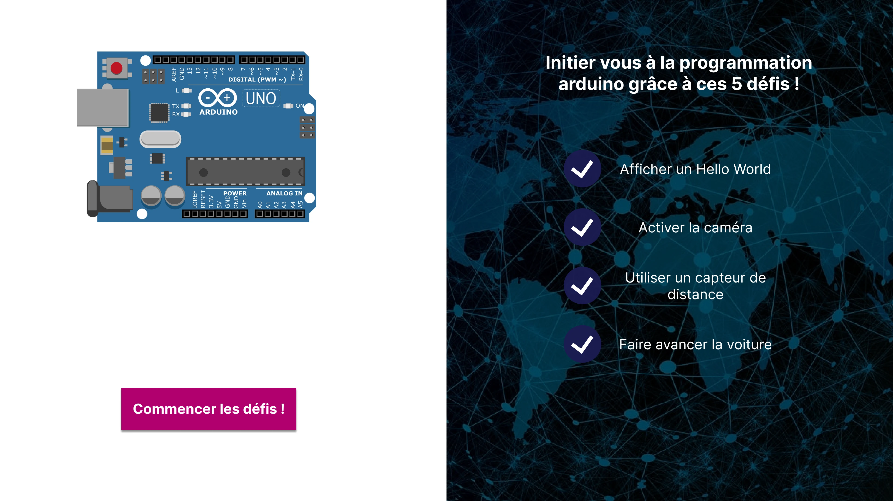
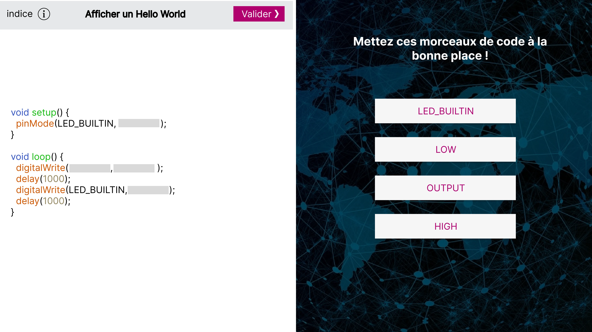
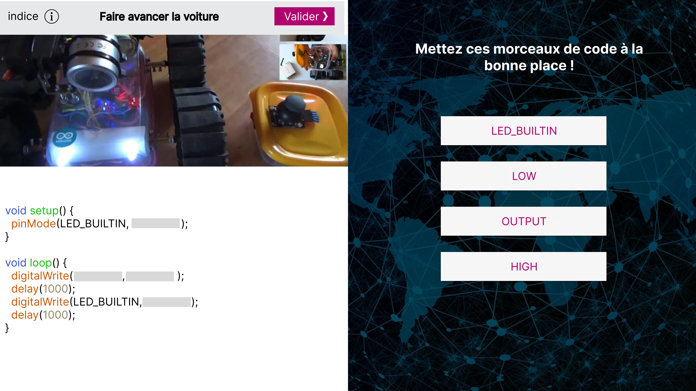
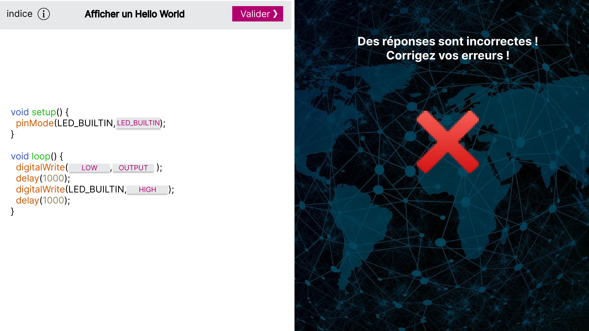
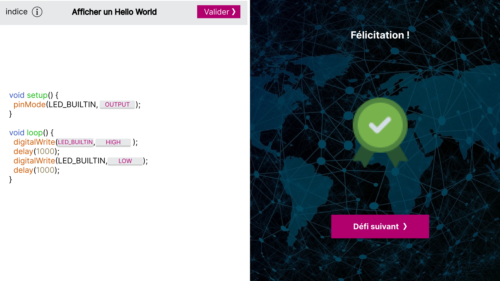

## Contexte

CodeOnWheels est un projet pédagogique réalisé durant ma formation Epitech. Son objectif était d'initier des débutants à la programmation Arduino en reliant chaque exercice à une action visible sur un véhicule robotisé physique.

Plutôt que de se limiter à des exemples abstraits, l'application proposait des défis progressifs permettant de découvrir et de débloquer les fonctionnalités du robot.

## Problème

Comment rendre l'apprentissage des premières notions de programmation plus concret, motivant et accessible ? Le défi consistait à proposer une interface simple pour compléter du code, comprendre ses erreurs et observer un résultat réel sur le matériel.

## Mon rôle

J'ai pris en charge les trois aspects du projet : la conception UX/UI et les maquettes, le développement de l'application web Svelte, ainsi que la programmation du véhicule robotisé et de ses fonctionnalités embarquées.

## Parcours pédagogique

Les maquettes présentent un parcours de défis autour de la programmation Arduino : afficher un premier résultat, activer une caméra, utiliser un capteur de distance et faire avancer la voiture.

L'utilisateur place des éléments de code dans les emplacements prévus, puis valide sa réponse. En cas d'erreur, l'interface l'invite à corriger son code ; en cas de réussite, elle lui propose de passer au défi suivant.

*Accueil et progression par défis — maquette originale.*

*Exercice à trous : compléter le programme avec les instructions proposées.*

## Architecture et réalisation

L'interface pédagogique a été développée avec Svelte. Le véhicule s'appuyait sur un ESP32-CAM hébergeant un serveur web, ainsi que sur la programmation Arduino pour ses interactions matérielles.

Cette réalisation associait une application web, un serveur embarqué et un robot physique fonctionnel. Les défis permettaient de débloquer progressivement des fonctions du véhicule, notamment la caméra, les capteurs et le déplacement.

*Défi de déplacement avec photographie du véhicule physique — maquette originale.*

## Retours et progression

La validation des réponses faisait partie intégrante de l'expérience : un retour visuel signalait les erreurs et une confirmation de réussite donnait accès à l'étape suivante.

*Retour en cas de réponse incorrecte.*

*Validation du défi et accès à la suite du parcours.*

## Résultat et limites

Le projet a abouti à une application et à un véhicule robotisé réellement fonctionnels. Il m'a permis de concevoir et développer une expérience complète, de l'interface utilisateur à la programmation du matériel.

Le code source n'est plus disponible. Les captures présentées ici proviennent des maquettes originales du projet ; elles illustrent le parcours conçu, sans constituer une démonstration actuelle de l'application.

## Apprentissages

CodeOnWheels m'a permis d'aborder un produit de bout en bout : conception de l'expérience pédagogique, développement frontend, serveur web embarqué et interactions avec un objet physique. Le principal intérêt du projet réside dans le lien direct entre l'action de programmer et son effet concret.
