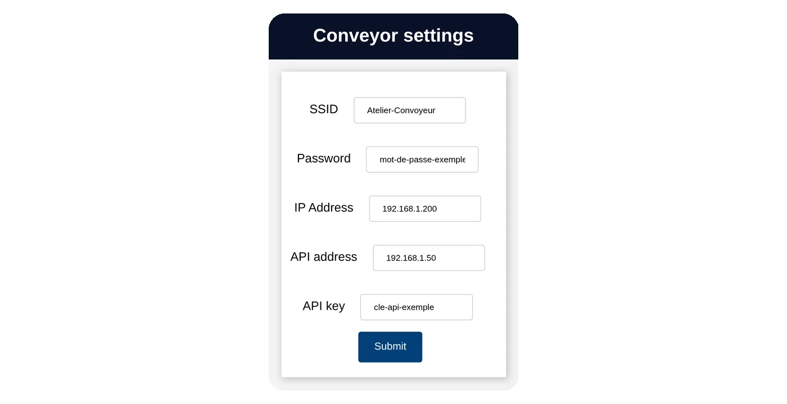

## Contexte

Ce projet a été réalisé en équipe pendant ma MSc IoT à Epitech, de septembre à novembre 2024. Il s’agissait de construire un convoyeur capable de trier des colis automatiquement, en s’appuyant sur un logiciel de gestion d’entreprise (ERP) pour savoir où envoyer chacun d’eux.

L’ERP utilisé est Dolibarr, un logiciel libre qui gère notamment les produits et les stocks. Il était lancé localement avec Docker pour le prototype.

## Problème

Sur un tapis, le tri ne peut pas attendre : chaque colis doit être identifié et orienté pendant qu’il avance. La carte doit donc faire plusieurs choses à la fois (faire tourner le tapis, lire les badges, interroger l’ERP, actionner l’aiguillage) et réagir correctement quand quelque chose se passe mal : colis inconnu, colis déjà traité ou ERP injoignable.

## Mon rôle

J’ai écrit l’essentiel du code de la carte M5GO, qui pilote tout le convoyeur, avec l’aide d’un autre membre de l’équipe :

- la lecture des badges RFID des colis
- les appels à l’API REST de Dolibarr
- la commande du servomoteur d’aiguillage et du moteur du tapis
- la gestion des erreurs et la page de configuration de la carte

Le reste de l’équipe a travaillé sur les autres parties du projet. Le convoyeur fonctionnait de bout en bout lors de la soutenance : lecture du badge, appel à l’ERP, aiguillage et avance du tapis.

## Fonctionnement

Le convoyeur est piloté par un M5Stack M5GO, un boîtier construit autour d’un ESP32 avec un écran et trois boutons.

1. Un lecteur RFID lit le badge collé sur le colis. Son identifiant sert de référence produit dans Dolibarr.
2. La carte interroge l’API de Dolibarr pour récupérer le produit et son entrepôt par défaut.
3. Un servomoteur oriente le colis vers l’entrepôt 1, l’entrepôt 2 ou le rebut.
4. La carte indique ensuite à Dolibarr que le colis a été acheminé, pour qu’il ne soit pas traité deux fois.

Le tapis est entraîné par un moteur pas à pas, commandé en G-code par un module dédié. Le bouton A le démarre, le met en pause ou le relance.

## Décisions techniques

### L’ERP comme source de vérité

La carte ne connaît aucun colis à l’avance : elle se contente de lire un identifiant et de demander à Dolibarr ce qu’il faut en faire. Changer la destination d’un colis se fait donc dans l’ERP, sans toucher au code du convoyeur.

### S’arrêter plutôt que de mal trier

Quand le doute est possible, le convoyeur s’arrête au lieu de continuer :

- si l’API est injoignable, le tapis se met en pause, le colis part au rebut et l’écran affiche en rouge qu’une intervention humaine est nécessaire
- si le colis a déjà été acheminé, le tapis s’arrête aussi
- un colis inconnu de l’ERP ou une réponse illisible envoie le colis au rebut

### Deux tâches en parallèle

La lecture des badges et la commande du moteur tournent dans deux tâches FreeRTOS distinctes. Le tapis continue ainsi de répondre au bouton pendant qu’une requête vers l’ERP est en cours.

### Configurer la carte sans la reprogrammer

Au premier démarrage, ou si le réseau enregistré est introuvable, la carte ouvre son propre point d’accès Wi-Fi et sert une page de configuration : réseau, adresse IP, adresse et clé de l’API Dolibarr. Ces réglages sont conservés dans la mémoire de la carte. La position de l’aiguillage pour le dernier colis est aussi enregistrée et rétablie au redémarrage.

*Page de configuration servie par la carte, reconstituée à partir du code du projet avec des valeurs fictives.*

## Limites

- La page de configuration était préremplie avec les identifiants Wi-Fi et la clé d’API utilisés pendant le développement, écrits dans le code. Ces valeurs s’affichent aussi en clair sur l’écran de la carte au moment de la saisie. Un déploiement réel demanderait de les retirer et de protéger cette page.
- L’enregistrement des mouvements de stock dans Dolibarr a été écrit et testé, mais il est désactivé dans la version finale : seul le statut du colis est mis à jour.
- Les deux entrepôts et les angles de l’aiguillage sont fixés dans le code, et tout le programme tient dans un seul fichier.

## Apprentissages

Ce projet m’a fait travailler sur un objet qui agit physiquement, là où Sensor Sensei mesurait et transmettait des données. Une erreur n’y produit pas seulement un message : elle envoie un colis au mauvais endroit. J’ai appris à prévoir chaque cas d’échec et à choisir un comportement sûr par défaut.

Il m’a aussi permis de relier mes deux domaines : un objet connecté qui s’appuie sur l’API REST d’un logiciel métier, comme une application web le ferait.
