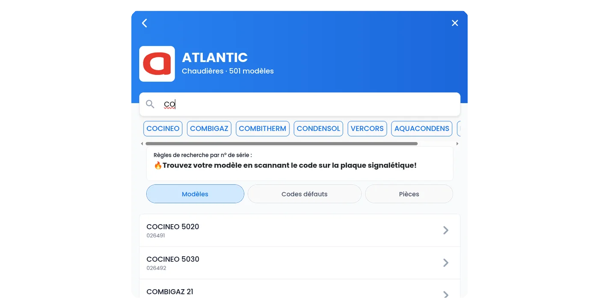
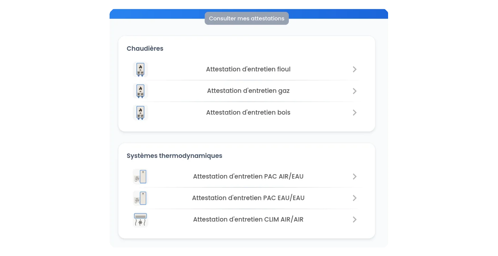

## Contexte

EasySAV est une startup messine qui aide les techniciens du génie climatique (chaudières, pompes à chaleur, climatisations…) à trouver rapidement l’information technique dont ils ont besoin : notices, vues éclatées, pièces détachées, codes défauts. L’outil propose aussi la rédaction d’attestations d’entretien.

Pendant mon alternance, commencée en 2021 lors de ma formation à la Web@cadémie puis poursuivie pendant mon MSc à Epitech, j’ai travaillé au sein de l’équipe de développement web, sur l’application Symfony déjà en production, aux côtés d’une UX designer, d’experts métier et de l’équipe chargée de la base de données.

## Problème

Les attestations sont des formulaires métier longs, avec de nombreuses informations techniques à renseigner sur le terrain, par des techniciens en mobilité. La difficulté était de réduire les saisies répétitives, les oublis et les erreurs tout en respectant les contraintes réglementaires et le fonctionnement existant de l’application.

L’entreprise élargissait en même temps son activité à de nouveaux équipements. Chaque type d’appareil demandait sa propre attestation, alors que le code existant de ces formulaires était en grande partie dupliqué.

## Mon rôle

Mon rôle était principalement technique : intégrer les évolutions dans l’application existante et proposer des solutions adaptées aux contraintes métier. Les écrans étaient maquettés par l’UX designer, et les règles des attestations étaient validées avec un expert des chaudières et des équipements.

Je suis notamment intervenu sur la refactorisation du code et du CSS, la refonte visuelle de l’attestation d’entretien, l’amélioration de la recherche, le préremplissage, l’ajout de nouveaux types d’attestations et l’interface d’administration. J’ai développé le mode brouillon avec un autre développeur de l’équipe.

## Démarche

Les besoins partaient de cas métier concrets remontés par l’équipe et les utilisateurs. Pour chaque évolution, il fallait comprendre le fonctionnement attendu, identifier ce qui pouvait être automatisé ou simplifié, puis intégrer la solution sans casser les attestations déjà en production.

*Recherche d’un modèle dans une marque : la liste tolère les fautes de frappe et les saisies partielles.*

La recherche de modèles en est un exemple. L’ancienne implémentation reposait sur un filtrage manuel qui renvoyait souvent des résultats peu pertinents. J’ai proposé et intégré Fuse.js, une bibliothèque de recherche floue, pour tolérer les fautes de frappe et les erreurs de saisie dans l’interface existante.

## Décisions importantes

- **Factoriser avant d’ajouter :** les formulaires d’attestation partageaient une structure proche mais dupliquée. J’ai extrait les parties communes, puis écrit deux scripts qui génèrent, à partir d’un export de données, les groupes de formulaire, les accesseurs, le rendu PDF et l’entité Symfony avec ses relations. Ajouter une attestation est devenu nettement plus rapide et le code produit plus homogène.
- **Réutiliser l’attestation de l’année précédente :** un technicien revient en général chaque année chez le même client. Le formulaire reprend donc les données saisies lors de la dernière attestation, ce qui évite de tout ressaisir et limite les écarts d’une année sur l’autre.
- **Permettre de reprendre un travail interrompu :** le mode brouillon distingue trois statuts : brouillon, à signer (attestation prête mais client pas encore disponible pour signer), terminé.
- **Exploiter les appareils de mesure du terrain :** les analyseurs Testo génèrent un QR code contenant leurs mesures. Le scanner remplit automatiquement une partie du formulaire au lieu de recopier les valeurs à la main.
- **Rendre l’équipe base de données autonome :** dans l’interface d’administration EasyAdmin, j’ai ajouté les nouveaux équipements et leurs éléments associés (fichiers techniques, codes défauts, sondes) pour que l’équipe puisse gérer les nouveaux modèles sans passer par les développeurs.

## Solution

Les évolutions ont été intégrées dans le socle Symfony / Twig / EasyAdmin afin de rester cohérentes avec le produit existant. Les écrans d’attestation, refondus d’après les maquettes de l’UX designer, sont structurés en étapes et en blocs métier : informations sur le modèle, points de contrôle, mesures et données techniques. Chaque étape permet d’enregistrer un brouillon.

*Étapes d’une attestation d’entretien sur mobile, avec le scan du QR code Testo avant les mesures.*

En s’appuyant sur le code factorisé, j’ai ajouté les attestations pour les chaudières bois, les pompes à chaleur air/eau et eau/eau et les climatisations, en plus des chaudières fioul et gaz. J’ai aussi développé un convertisseur GWP pour les fluides frigorigènes, qui aide à renseigner les attestations des systèmes thermodynamiques.

*Types d’attestations disponibles, dont les quatre que j’ai ajoutés : bois, PAC air/eau, PAC eau/eau et climatisation.*

Côté front, j’ai aussi remplacé la feuille de style unique `global.css` par une organisation SCSS en modules (base, utilitaires, disposition, composants, pages, thèmes), pour rendre les styles plus faciles à faire évoluer.

## Collaboration avec Testo

Après l’intégration du QR code, une réunion a été organisée avec Testo pour leur présenter notre usage. En analysant ensemble des résultats réels, nous avons constaté que les données encodées dans leurs QR codes étaient en partie incorrectes ou difficiles à exploiter.

J’ai détaillé les limites rencontrées côté développement, et Testo a ensuite ajusté le format et la qualité des données transmises. L’intégration côté EasySAV est devenue plus fiable.

## Résultats

Ces évolutions ont été livrées dans un outil métier déjà utilisé en production : moins de saisies pour certaines tâches, une saisie plus sûre, de nouveaux équipements pris en charge et une équipe base de données plus autonome. Je n’ai pas de métriques permettant d’attribuer un gain précis à mon travail. Je préfère donc m’en tenir aux améliorations réellement livrées plutôt que d’inventer un impact chiffré.

## Apprentissages

EasySAV m’a appris qu’une amélioration utile n’est pas forcément une refonte complète : factoriser l’existant m’a ensuite permis d’aller plus vite sur chaque nouvelle attestation.

J’ai aussi appris à traduire des contraintes métier en solutions techniques, à collaborer avec des profils design et métier sans confondre les rôles de chacun, et à communiquer plus tôt. Mon tuteur m’a encouragé à remonter les points bloquants dès qu’ils apparaissent et à mieux anticiper les fins de livraison, des pratiques que j’ai progressivement intégrées à mon quotidien.
