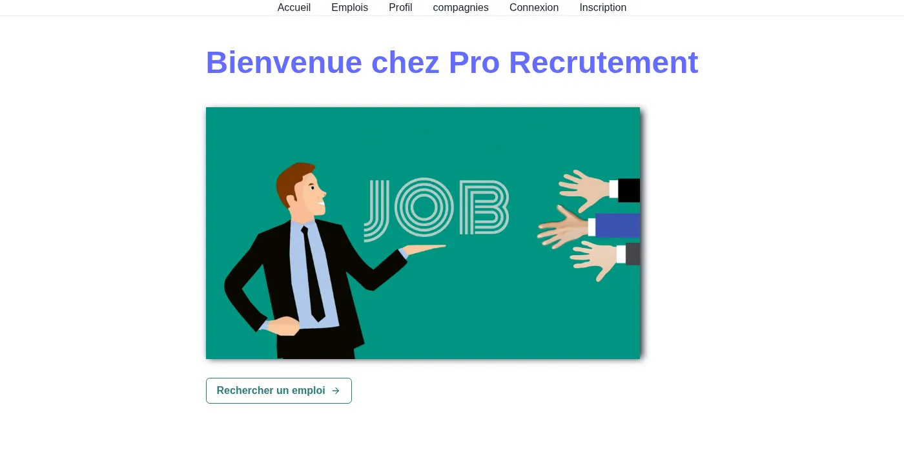
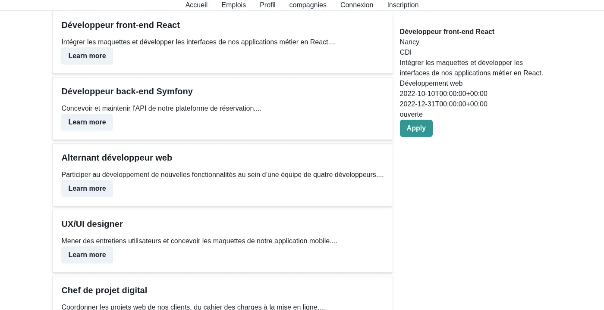
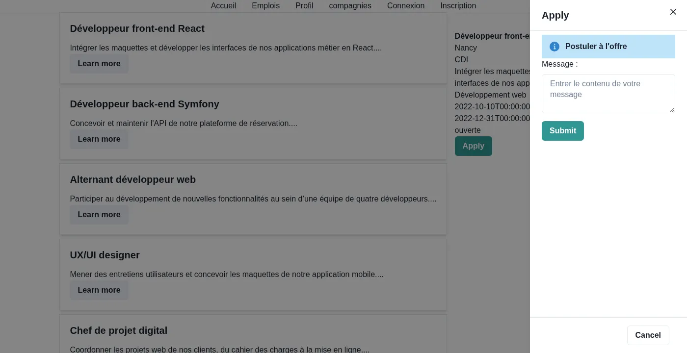
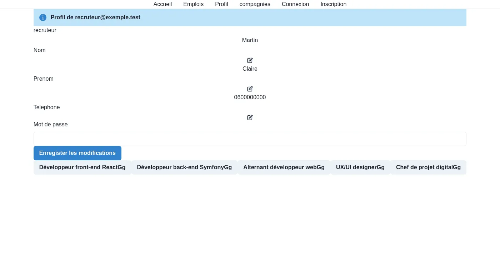

## Contexte

Job Board est un projet de ma Pré-MSc à Epitech, réalisé en binôme sur trois semaines, de fin septembre à mi-octobre 2022. Le sujet demandait une plateforme d'offres d'emploi : les candidats consultent les annonces et postulent, les recruteurs publient leurs offres et reçoivent les candidatures.

Nous l'avons appelée « Pro Recrutement ».

## Problème

Deux publics utilisent la même plateforme avec des besoins opposés : le candidat veut trouver une offre et postuler rapidement, le recruteur veut publier et suivre ses annonces. Il fallait donc une API qui distingue les deux types de compte, protège les données de chacun et serve une interface unique, adaptée au rôle de la personne connectée.

## Mon rôle

J'ai réalisé la plus grande partie du dépôt, côté serveur comme côté interface :

- la mise en place de l'API avec Symfony et API Platform, les entités (utilisateurs, entreprises, offres, CV, messages) et leurs relations ;
- l'authentification par jeton JWT : inscription, connexion et route renvoyant le profil de l'utilisateur connecté ;
- l'interface d'administration des données, générée avec EasyAdmin ;
- côté React, la liste et le détail des offres, et l'espace recruteur : modification du profil et du mot de passe, création d'entreprises et d'offres, lecture des messages reçus.

Mon binôme a développé la page d'accueil, la page des entreprises et les premières versions du profil et des formulaires.

## Architecture

- **API** : Symfony 5.4 et API Platform exposent chaque entité en REST. Les routes propres à l'authentification (inscription, connexion, profil courant) sont des contrôleurs dédiés. Les mots de passe sont hachés avec Argon2.
- **Authentification** : à la connexion, l'API renvoie un jeton JWT que le front conserve et envoie pour les actions réservées aux comptes connectés.
- **Interface** : React avec Vite, Chakra UI pour les composants et React Hook Form pour les formulaires et leurs messages d'erreur. Deux petits hooks centralisent les appels à l'API.
- **Administration** : EasyAdmin fournit un tableau de bord pour gérer utilisateurs, offres, entreprises, CV et messages sans développer d'écrans supplémentaires.

*La page d'accueil.*

## Le parcours candidat

Les offres sont listées avec un résumé. Un clic affiche leur détail à côté de la liste, sans changer de page : contrat, lieu, métier, dates de publication et de validité.

*La liste des offres et le détail de l'offre sélectionnée.*

Pour postuler, le candidat ouvre un panneau latéral et écrit un message au recruteur. S'il n'a pas de compte, le même formulaire lui demande ses coordonnées et lui en crée un avant d'envoyer la candidature : il n'a pas à passer par l'inscription au préalable.

*Le panneau de candidature, ici pour un utilisateur déjà connecté.*

## L'espace recruteur

Une fois connecté, le recruteur retrouve sur la même page son profil, ses entreprises et ses offres publiées. Pour chaque offre, il peut consulter les messages des candidats.

*L'espace recruteur : profil modifiable et onglets des offres publiées.*

Les captures de cette page ont été réalisées en 2026, en relançant le projet d'origine sur ma machine avec une base de données locale et des comptes, entreprises et offres fictifs.

## Résultat et limites

L'application livrée permet de s'inscrire comme candidat ou recruteur, de se connecter, de consulter les offres, de postuler et, côté recruteur, de publier des offres et de lire les candidatures.

Plusieurs points restaient inachevés :

- la recherche et le filtrage des offres étaient en cours de développement à la fin du projet ;
- les dates s'affichent dans leur format technique, sans mise en forme ;
- l'interface conserve des libellés en anglais (« Learn more », « Apply ») et une mise en page très simple, sans travail de conception visuelle ;
- seules les données des utilisateurs exigent d'être connecté : les offres, entreprises, CV et messages peuvent être lus et modifiés sans authentification, et le tableau de bord d'administration n'est pas protégé. Le jeton JWT était en place, mais les règles d'accès n'avaient pas été écrites.

## Apprentissages

Job Board m'a fait concevoir une API complète, de la modélisation des données à l'authentification, puis la consommer dans une interface React. C'est aussi le projet où j'ai le mieux mesuré l'écart entre une fonctionnalité qui marche et une interface agréable à utiliser : les parcours étaient complets, mais leur présentation n'avait pas été pensée. C'est précisément ce que ma formation en conception m'apprend aujourd'hui à traiter.
