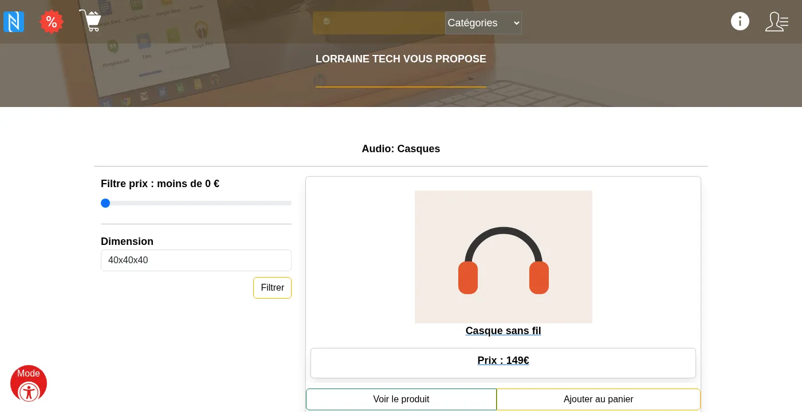
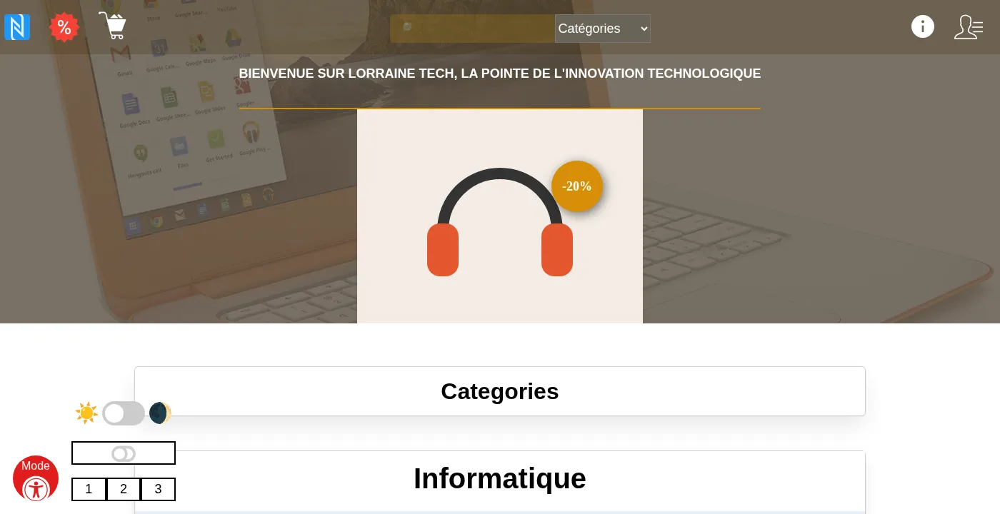
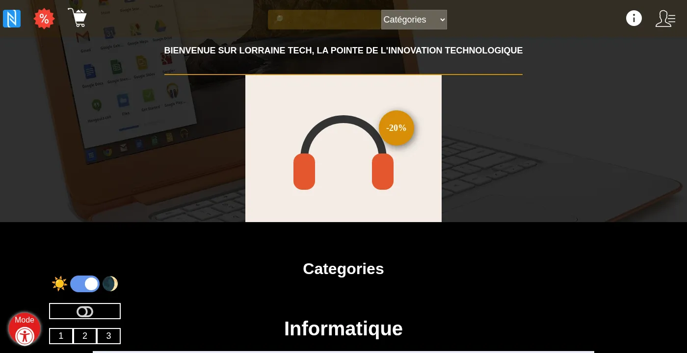
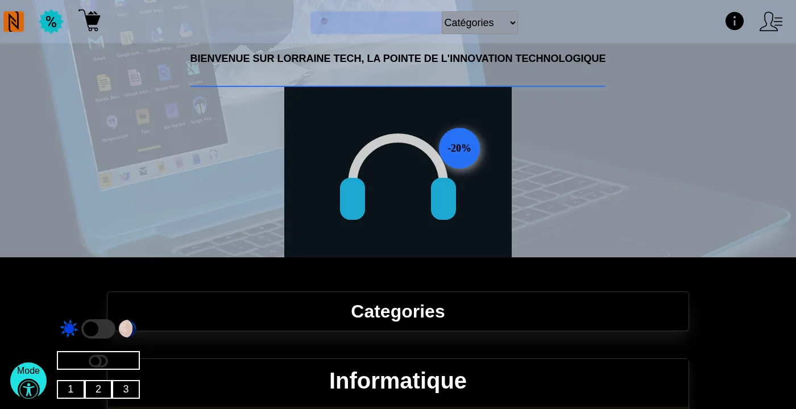

## Contexte

Lorraine Tech est une boutique en ligne de produits high-tech réalisée en deux temps pendant la Web@cadémie d'Epitech, avec la même équipe de quatre développeurs.

- **Été 2021** : développement de la boutique, avec un front React et une API Symfony.
- **Printemps 2022** : dans un module consacré au développement responsable, nous avons repris ce front pour le rendre plus accessible et l'installer comme une application (PWA).

## Problème

La première version fonctionnait, mais elle avait été conçue sans réfléchir aux personnes qui naviguent autrement : au clavier, avec une vue réduite, ou dans un environnement lumineux qui fatigue les yeux. La question du second projet était donc : que peut-on améliorer sur un site existant, sans tout reconstruire, pour qu'il soit utilisable par plus de monde ?

## Mon rôle

En 2021, j'ai été le principal contributeur du dépôt et je me suis concentré sur le front-end :

- le panier, conservé dans le navigateur, avec les quantités, les doublons et le calcul du total
- l'accueil (catégories et carrousel des promotions) et les pages produit
- l'espace d'administration pour créer, modifier et supprimer articles, catégories et sous-catégories
- la liaison entre le front React et l'API Symfony.

Mes coéquipiers ont pris en charge le paiement PayPal, les frais de livraison, les commandes, les adresses, l'authentification et la recherche.

En 2022, j'ai ouvert la moitié des tickets du backlog d'accessibilité, puis développé le thème sombre, l'agrandissement du texte, l'inversion des couleurs et l'intégration de la PWA.

## La boutique

Les visiteurs parcourent les produits par catégorie et sous-catégorie, filtrent par prix et ajoutent des articles au panier. Le panier est enregistré dans le navigateur : il reste disponible d'une page à l'autre et entre deux visites.

*Page d'une sous-catégorie. Capture réalisée en 2026 en relançant le front d'origine avec des produits et des images fictifs.*

## Le volet accessibilité

### Partir d'un backlog

Avant de coder, nous avons listé les besoins dans des tickets GitHub, classés par public : navigation au clavier, personnes malvoyantes (agrandissement, inversion des couleurs, lecture vocale), personnes malentendantes (sous-titres), mais aussi normes de contraste, performances et bilan carbone. Cette liste a servi de feuille de route, même si tous les tickets n'ont pas été réalisés.

### Un panneau d'options

Toutes les options sont regroupées derrière un même bouton « Mode », toujours visible en bas de l'écran. Cette solution laisse l'interface d'origine intacte et permet d'activer une option sans quitter la page.

*Le panneau d'options : thème clair ou sombre, inversion des couleurs et trois tailles de texte.*

### Thème sombre

Le thème respecte d'abord la préférence de l'appareil (clair ou sombre), puis mémorise le choix fait dans le panneau. Les couleurs principales sont définies par des variables CSS, redéfinies pour le thème sombre : il n'a pas fallu reprendre chaque composant.

*Le thème sombre, activé depuis le panneau.*

### Taille du texte et inversion des couleurs

Trois boutons appliquent une taille de texte à toute la page. L'inversion des couleurs applique un filtre à l'ensemble du document, pour les personnes qui lisent mieux un texte clair sur fond foncé.

*L'inversion des couleurs s'applique aussi aux images des produits, ce qui les rend méconnaissables.*

### Une application installable

J'ai ajouté un manifeste et un service worker : le site peut être installé comme une application et affiche une page dédiée lorsque la connexion est perdue.

## Résultat et limites

Le front livré en 2022 propose un thème sombre, trois tailles de texte, une inversion des couleurs et un fonctionnement en PWA.

Avec le recul, plusieurs choix ne tiennent pas face aux règles d'accessibilité que j'applique aujourd'hui :

- l'inversion des couleurs touche aussi les photos des produits, alors qu'il aurait fallu les exclure du filtre
- les boutons « 1 », « 2 », « 3 » et l'interrupteur de thème n'ont pas de nom accessible : un lecteur d'écran ne peut pas dire à quoi ils servent
- les photos des produits partagent le même texte alternatif générique, et le bouton qui diminue une quantité est annoncé comme « supprimer »
- la navigation au clavier n'a pas abouti : l'invite prévue, rédigée en anglais sur un site en français, n'est jamais affichée
- la lecture vocale a été développée par un coéquipier, mais le composant n'a jamais été ajouté au dépôt. Les sous-titres n'ont pas été réalisés.

Le site n'a pas été mis en ligne, et les tickets consacrés aux performances et au bilan carbone sont restés au stade d'intention : aucune mesure n'a été réalisée.

Les captures de cette page ont été réalisées en 2026, en relançant le front d'origine sur ma machine avec une API simulée : le back-end Symfony n'est plus disponible.

## Apprentissages

Ce projet m'a appris qu'on ne rend pas un site accessible en ajoutant des options par-dessus. Le panneau était visible et facile à présenter, mais les problèmes les plus importants se trouvaient dans le balisage : noms des boutons, textes alternatifs, langue des messages. C'est aujourd'hui le premier point que je vérifie, avant toute option d'affichage.
