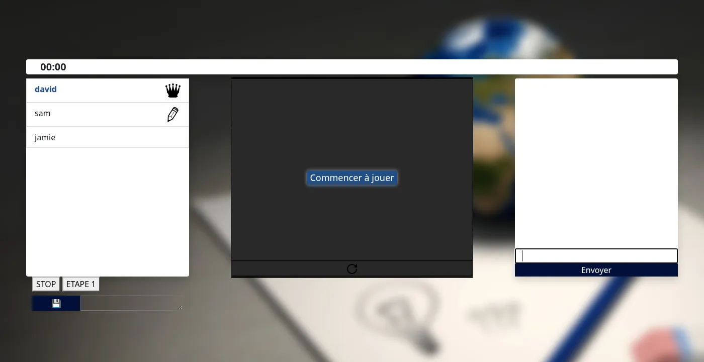
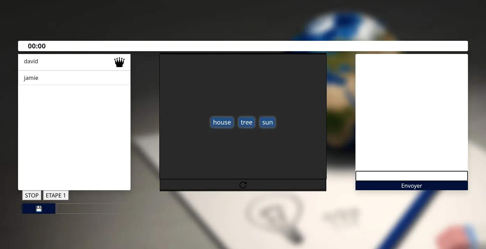
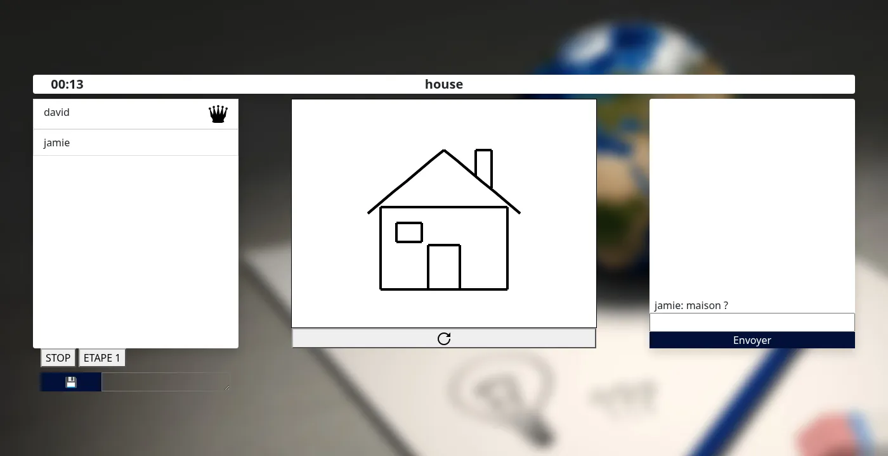
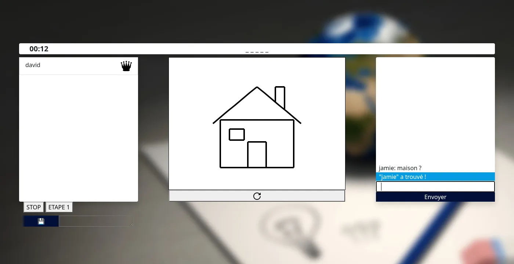

## Contexte

MyGo est un jeu de dessin multijoueur réalisé à trois en mai 2022 pendant la Web@cadémie d'Epitech. Le principe reprend celui des jeux de type « dessine et devine » : à chaque manche, un joueur choisit un mot et le dessine, et les autres doivent le trouver dans le chat avant la fin du temps.

Le sujet était imposé, tout comme le langage du serveur : Go. L'interface, elle, tourne dans le navigateur.

## Problème

Tout l'intérêt du jeu repose sur la simultanéité. Chaque trait doit apparaître presque immédiatement chez les autres joueurs, tous les participants doivent passer en même temps d'une étape à l'autre (attente, choix du mot, dessin, résultat) et plusieurs parties doivent pouvoir se dérouler en parallèle sans se mélanger.

## Mon rôle

J'ai réalisé l'essentiel du projet : 126 des 139 commits du dépôt. Je me suis concentré sur l'interface de jeu et sur le déroulement de la partie :

- la création d'un salon et le lien à copier pour inviter d'autres joueurs
- le canevas de dessin partagé et son effacement
- les étapes de la partie, déclenchées par des messages WebSocket
- le chat, le chronomètre, le mot masqué et l'annonce du joueur qui a trouvé.

Les deux autres membres de l'équipe ont travaillé avec moi sur le serveur Go, notamment sur la conservation des informations de chaque salon et sur le chat.

## Architecture

Le serveur Go, construit avec le framework Gin, sert les pages et ouvre une connexion WebSocket par joueur. Un « hub » central range ces connexions par salon et rediffuse chaque message aux seuls joueurs du même salon. Ce hub s'inspire de l'exemple de chat fourni avec la bibliothèque Gorilla WebSocket, étendu à plusieurs salons.

Côté navigateur, l'interface est écrite en JavaScript sans framework : j'ai essayé Mithril en cours de projet, puis je suis revenu à du JavaScript natif.

*Le salon avant la partie : la couronne désigne l'administrateur, le crayon le joueur qui dessine.*

## Le déroulement d'une partie

### Des étapes partagées

La partie est découpée en étapes : attente, choix du mot, dessin, résultat. Quand un joueur déclenche une étape (l'administrateur qui lance la partie, le dessinateur qui choisit son mot), le navigateur envoie un message au serveur, qui le rediffuse à tout le salon. Chaque navigateur affiche alors la même étape, adaptée au rôle du joueur.

*Le dessinateur choisit parmi trois mots tirés d'une API de mots aléatoires.*

### Un dessin partagé

Chaque trait est envoyé sous forme de coordonnées et redessiné sur le canevas des autres joueurs. Pendant ce temps, le dessinateur voit le mot en clair et les autres le voient masqué, chaque lettre étant remplacée par un tiret bas. Un chronomètre limite chaque manche à 30 secondes.

*Vue du dessinateur : le mot est affiché en clair et le canevas est actif.*

### Deviner dans le chat

Les propositions passent par le chat. Lorsqu'un message contient le mot à trouver, il n'est pas affiché tel quel : le chat annonce seulement que le joueur a trouvé, pour ne pas donner la réponse aux autres.

*Une mauvaise proposition, puis la bonne : le chat annonce « jamie a trouvé » sans révéler le mot.*

Les captures de cette page ont été réalisées en 2026, en relançant le serveur d'origine sur ma machine et en simulant une partie à trois joueurs. Les mots proposés ont été imposés pour pouvoir dessiner une maison.

## Résultat et limites

Le prototype permet de créer un salon, d'y inviter des joueurs et de jouer une manche complète : choix du mot, dessin partagé en temps réel, propositions dans le chat et annonce du joueur qui a trouvé.

Il reste cependant un prototype :

- les rôles d'administrateur et de dessinateur sont attribués à des pseudos écrits dans le code, sans rotation entre les joueurs
- la liste des joueurs n'est pas la même d'un écran à l'autre, car chaque navigateur la reconstruit à partir des messages qu'il a reçus
- les messages sont lus côté serveur en découpant le texte, au lieu d'être décodés comme du JSON, ce qui les rend fragiles
- les boutons de test (« STOP », « ETAPE 1 ») sont restés dans l'interface, et il n'y a ni score ni fin de partie.

## Apprentissages

MyGo a été ma première expérience d'un état partagé entre plusieurs clients : décider qui déclenche une étape, qui la rediffuse et ce que chaque joueur doit voir selon son rôle. Les limites du prototype m'ont surtout appris qu'un jeu en temps réel a besoin d'une seule source de vérité : c'est au serveur, et non à chaque navigateur, de connaître les joueurs, les rôles et l'étape en cours.
