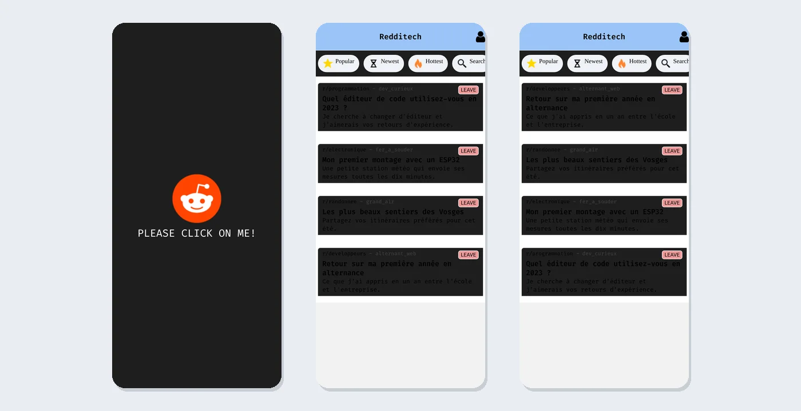
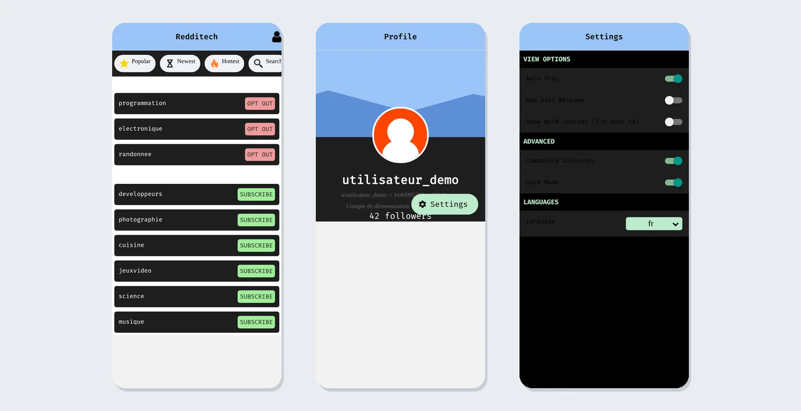

## Contexte

Redditech est une application mobile réalisée à trois pendant ma Pré-MSc à Epitech, de mi-février à mi-mars 2023. Le sujet, imposé par le module, demandait de développer en React Native un client pour Reddit qui utilise son API officielle : se connecter avec son compte, consulter son fil, gérer ses abonnements et modifier ses réglages.

## Problème

Une application qui agit sur le compte de l'utilisateur ne peut pas lui demander son mot de passe : elle doit passer par la connexion OAuth2 de Reddit et conserver l'autorisation obtenue sans redemander une connexion à chaque ouverture. Il fallait ensuite organiser à trois, en un mois, des écrans qui dépendent tous de cette session.

## Mon rôle

J'ai réalisé la majorité du projet (44 commits sur 60) :

- la création du projet React Native et la navigation entre les écrans ;
- la connexion OAuth2 et la conservation du jeton de renouvellement sur le téléphone ;
- le fil d'actualité et ses filtres ;
- l'abonnement et le désabonnement aux communautés, côté API ;
- la documentation du dépôt, le test Jest et la publication de la version 1.0.0.

Mes deux coéquipiers ont pris en charge l'intégration de l'interface (connexion, accueil, profil, recherche), la récupération du profil et l'écran des réglages.

## Architecture et décisions

### Une connexion qui dure

La connexion ouvre la page d'autorisation de Reddit et demande une autorisation permanente. L'application conserve le jeton de renouvellement dans le stockage du téléphone, puis l'utilise pour obtenir de nouveaux jetons d'accès sans repasser par la connexion.

### S'appuyer sur une bibliothèque cliente

Les listes de publications passent par snoowrap, une bibliothèque cliente de l'API Reddit, qui gère elle-même le renouvellement des jetons. Les appels plus ponctuels (profil, abonnements, réglages) passent directement par l'API.

### Un dépôt prêt à accueillir d'autres développeurs

Dès le début du projet, j'ai rédigé un README, un guide de contribution (une branche par fonctionnalité, des messages de commit explicites) et un journal des modifications au format Keep a Changelog, avec un numéro de version pour chaque livraison : 0.0.1 pour la connexion, 1.0.0 pour la version finale. Un test Jest vérifie le rendu du composant qui affiche une publication.

## L'application

L'utilisateur se connecte en touchant le logo, puis arrive sur son fil. Trois filtres (« Popular », « Newest », « Hottest ») changent la liste affichée.

*La connexion, puis le fil avec ses filtres.*

L'onglet « Search » liste les communautés auxquelles l'utilisateur est abonné, avec un bouton pour se désabonner, puis des communautés populaires auxquelles s'abonner. Le profil affiche les informations du compte et mène aux réglages, où six préférences sont modifiables et enregistrées sur Reddit.

*Abonnements, profil et réglages du compte.*

Ces captures ne viennent pas d'un téléphone. Elles ont été réalisées en 2026 en affichant les écrans d'origine dans un navigateur avec React Native Web, sans connexion à Reddit : le compte, les publications et les communautés sont fictifs, et l'apparence peut différer légèrement de celle de l'application sur Android.

## Résultat et limites

La version 1.0.0 couvre les fonctionnalités prévues : connexion, fil filtrable, profil, abonnements et réglages. La procédure pour produire l'application Android est documentée dans le dépôt.

Plusieurs points montrent le manque de recul de l'époque :

- les trois listes sont chargées à l'ouverture du fil, au lieu de l'être à la demande ;
- la recherche se limite à la liste des communautés populaires, sans champ de recherche ;
- la date de création du compte s'affiche en secondes brutes, sans mise en forme ;
- l'interface mélange anglais et français ;
- l'identifiant de l'application Reddit est écrit dans le code au lieu d'être fourni par la configuration.

## Apprentissages

Redditech m'a fait découvrir le développement mobile et l'authentification déléguée : ce qu'une application peut conserver sur le téléphone, et ce qu'elle ne doit jamais demander. C'est aussi le projet où j'ai le plus documenté ma façon de travailler, avec un guide de contribution, un journal des modifications et des versions numérotées, des habitudes que l'on retrouve dans mes projets suivants.
