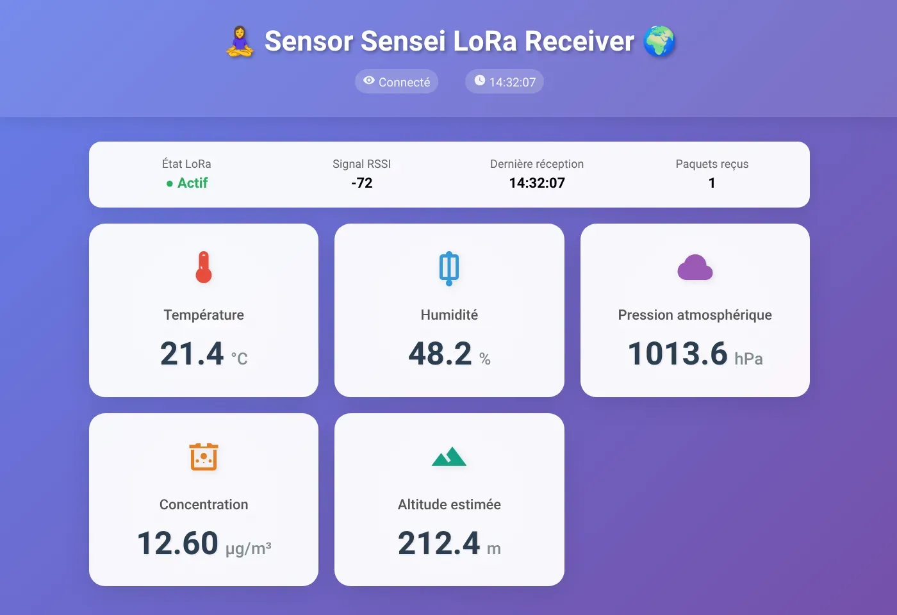

## Contexte

Sensor Sensei est un projet réalisé à quatre pendant ma MSc IoT à Epitech, de mars à juillet 2025. Le sujet, imposé par le module, demandait de concevoir un capteur environnemental connecté, capable de mesurer la qualité de l'air et les conditions météorologiques locales.

## Problème

Beaucoup de capteurs environnementaux grand public envoient leurs mesures en Wi-Fi. Cette solution consomme de l'énergie et suppose un réseau à proximité, ce qui la rend peu adaptée aux zones rurales ou peu équipées.

Nous avons choisi LoRa, une technologie radio à longue portée et faible débit : un capteur placé à distance envoie ses mesures à une passerelle locale, seule à être reliée au Wi-Fi.

## Mon rôle

J'ai développé l'essentiel du code embarqué du prototype :

- la lecture des capteurs sur la carte émettrice ;
- l'envoi et la réception des mesures en LoRa ;
- l'affichage sur les écrans OLED des deux cartes ;
- le serveur web de la passerelle et la première version de sa page.

Les autres membres de l'équipe ont notamment retravaillé cette page, rédigé la documentation des composants et préparé la présentation finale.

## Architecture

Le prototype repose sur deux cartes Heltec WiFi LoRa 32 V3, construites autour d'un ESP32-S3 avec une puce radio LoRa et un petit écran OLED.

- **L'émetteur** lit un module BME280 (température, humidité, pression, altitude estimée) et un capteur optique de poussières. Il assemble les valeurs dans un message court, l'affiche sur son écran et l'envoie en LoRa.
- **La passerelle** reçoit le message, le découpe, affiche les valeurs sur son écran et les publie sur une page web servie directement par la carte, accessible depuis un téléphone ou un ordinateur du même réseau.

## Décisions techniques

### Un message court

Une liaison LoRa transmet peu de données à la fois. Plutôt qu'un format structuré comme JSON, l'émetteur envoie une seule chaîne de texte : un numéro de mesure suivi des valeurs, séparées par des caractères distincts. La passerelle retrouve chaque valeur grâce à ces séparateurs et ignore un message incomplet plutôt que d'afficher des données fausses.

### Lisser la mesure des poussières

Le capteur de poussières renvoie une tension analogique qui varie d'une lecture à l'autre. À chaque lecture, la LED infrarouge du capteur est allumée brièvement, puis une moyenne glissante sur les dix dernières lectures est appliquée avant la conversion en µg/m³. La conversion repose sur les valeurs de référence du fabricant ; le capteur n'a pas été étalonné.

### Une page servie par la passerelle

La passerelle héberge elle-même son serveur web. La page affiche une carte par mesure et l'état de la liaison : force du signal reçu (RSSI) et heure de dernière réception. Chaque valeur est aussi exposée sur sa propre adresse (`/temperature`, `/humidity`…), ce qui permet de l'interroger depuis un autre outil.

*Page de la passerelle, reconstituée à partir du code du projet avec des valeurs d'exemple, sans capteur branché.*

### Une méthode de travail par fonctionnalité

Chaque étape du développement a suivi le même cycle : une branche dédiée (affichage à l'écran, transmission des poussières, page web, lecture du BME280), fusionnée dans une branche de développement une fois validée sur le matériel.

## Résultat et limites

Le prototype livré mesure la température, l'humidité, la pression et la concentration de poussières, les transmet en LoRa et les affiche en temps réel sur les écrans et sur la page web de la passerelle.

Plusieurs fonctions prévues n'ont pas été réalisées dans cette version :

- la mise en veille profonde entre deux mesures : l'émetteur mesure et transmet en continu, ce qui limite son autonomie ;
- la publication des données sur la plateforme ouverte sensor.community ;
- la conservation d'un historique des mesures.

La portée de la liaison et l'autonomie du capteur n'ont pas été mesurées sur le prototype : les distances citées dans notre présentation finale correspondaient aux capacités annoncées pour LoRa, pas à des essais.

Le capteur de poussières fournit une concentration globale, sans distinguer les tailles de particules. Enfin, les identifiants Wi-Fi sont écrits dans le code ; un déploiement réel demanderait une étape de configuration.

## Apprentissages

Ce projet m'a fait passer du web à des contraintes très différentes : messages de quelques dizaines d'octets, lectures de capteurs bruitées, écrans de 128 × 64 pixels et mise au point directement sur le matériel. Il complète CodeOnWheels, où l'objet connecté servait un parcours pédagogique : ici, c'est la chaîne de mesure et de transmission elle-même qui faisait l'objet du travail.
