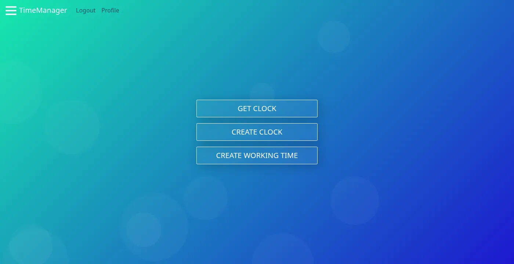
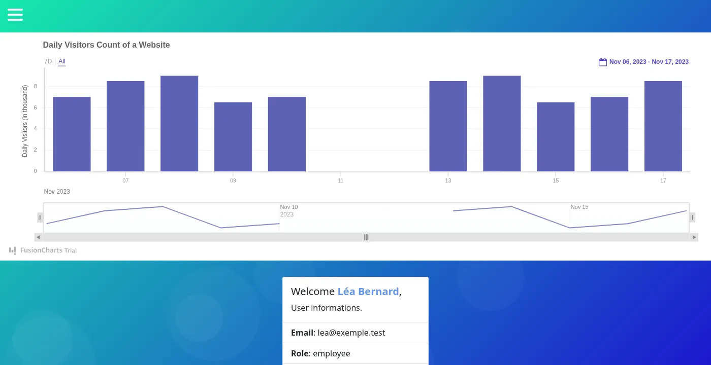
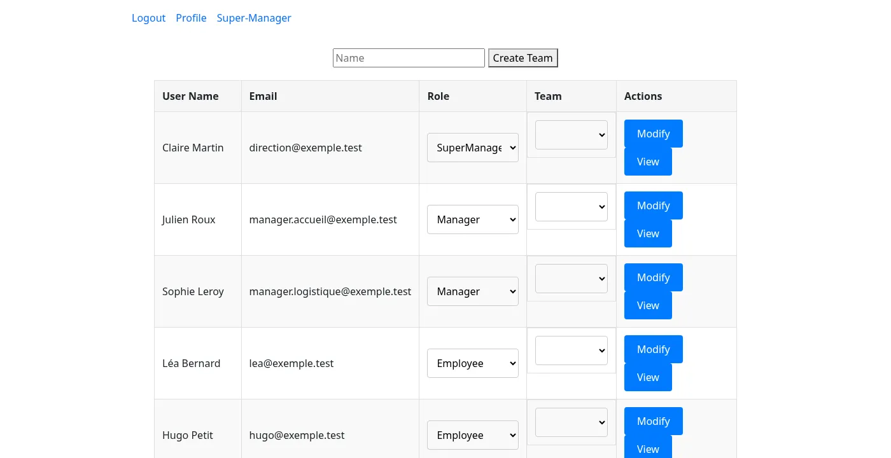

## Contexte

Time Manager est une application de gestion du temps de travail réalisée à quatre pendant ma MSc à Epitech, en octobre et novembre 2023, sur un sujet imposé par le module. Elle permet aux employés de pointer et d'enregistrer leurs heures, et aux responsables de suivre le temps de travail de leurs équipes.

## Problème

Les mêmes données de pointage intéressent trois publics : l'employé veut voir ses propres heures, le manager suit son équipe et la direction organise les équipes et les rôles. Il fallait une API commune et une interface qui montre à chacun ce qui le concerne.

## Mon rôle

L'API en Elixir (Phoenix) a été développée surtout par mes coéquipiers. J'y ai contribué ponctuellement, pour les équipes et la liste des utilisateurs. Mes 30 commits sur 72 portent surtout sur l'interface SvelteKit :

- les pages de connexion, d'inscription et de profil, et la redirection des visiteurs non connectés
- le système d'équipes côté interface et la liste de tous les utilisateurs
- le menu de navigation
- les graphiques des heures travaillées
- les réglages de communication entre le front et l'API (CORS, ports).

J'ai aussi testé l'empaquetage de l'interface en application Android avec Capacitor.

## Architecture

- **API** : Elixir avec le framework Phoenix et la base PostgreSQL. Elle gère les utilisateurs, les pointages, les temps de travail et les équipes.
- **Interface** : SvelteKit, compilé en site statique, avec Bootstrap pour la mise en page.
- **Graphiques** : une série temporelle FusionCharts qui affiche les heures travaillées jour par jour, avec un sélecteur de période.
- **Déploiement** : Docker Compose pour lancer la base, l'API et l'interface ensemble, et une action GitHub qui construit les images.

## Trois rôles, trois vues

### L'employé

L'employé dispose de raccourcis pour pointer et enregistrer un temps de travail. Son tableau de bord affiche ses heures jour par jour, calculées à partir de l'heure de début et de l'heure de fin de chaque temps de travail.

*Les actions de pointage de l'employé.*

*Le tableau de bord d'une employée : ses heures sur deux semaines.*

### Le manager

Le manager cherche un employé par son nom ou filtre par équipe, puis affiche le graphique de ses heures.

### La direction

La direction attribue les rôles (employé, manager, direction), affecte chaque personne à une équipe, et crée ou supprime les équipes.

*La gestion des rôles et des équipes.*

Les captures de cette page ont été réalisées en 2026, en relançant le projet sur ma machine avec une base de données jetable et des personnes, équipes et horaires fictifs. Elles montrent la version du 12 novembre 2023, juste avant l'intégration de l'authentification par jeton (voir plus bas).

## Résultat et limites

Le prototype couvre le pointage, les temps de travail, les équipes, les trois rôles et les graphiques. Ses limites sont importantes :

- jusqu'au dernier jour, la connexion comparait le mot de passe dans le navigateur, après l'avoir reçu en clair de l'API
- un coéquipier a ajouté une authentification par jeton côté API le dernier jour, mais l'interface n'a pas été adaptée à temps : dans la version finale, la connexion et le chargement des graphiques ne fonctionnent plus
- les droits de chaque rôle ne sont vérifiés que dans l'interface, pas par l'API
- le graphique a gardé le titre et l'axe de l'exemple FusionCharts (« Daily Visitors… »), ainsi que le filigrane de la version d'essai
- l'interface mélange anglais et français, et l'application Android est restée au stade de l'essai.

## Apprentissages

Time Manager m'a montré à quel point l'authentification structure toute une application : ajoutée à la fin, elle a cassé ce qui fonctionnait la veille. J'en retiens qu'elle doit être conçue dès le début, avec des droits vérifiés côté serveur. Ce projet m'a aussi appris qu'un graphique n'est utile que si son titre, ses axes et ses unités disent clairement ce qu'il montre, ce que nous avions négligé.
