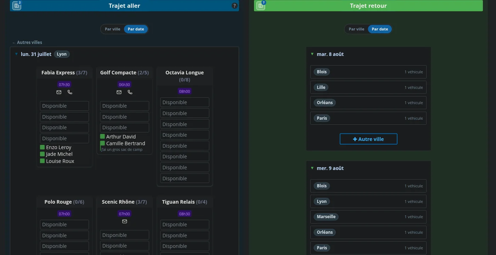
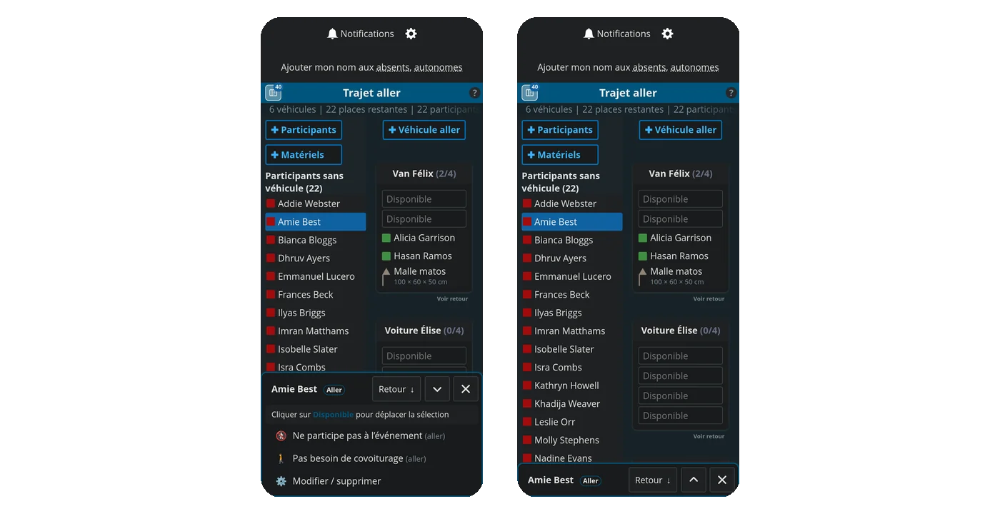

## Contexte

Vroum est un outil collaboratif de covoiturage développé au sein de l'association LaToileScoute. Il aide les organisateurs d'un événement à répartir participants, véhicules et matériel pour les trajets aller et retour.

Le produit est utilisé en conditions réelles et évolue depuis 2023 en fonction des usages et des besoins rencontrés sur différents événements.

## Problème

La complexité d'un covoiturage varie fortement selon la taille et l'organisation d'un événement. Lors d'un grand rassemblement scout, le nombre de véhicules a montré les limites d'une simple liste : l'information devenait difficile à parcourir et à organiser.

D'autres événements ont ensuite fait apparaître des besoins plus complexes, avec des véhicules venant de différentes villes et circulant sur plusieurs jours. Il fallait prendre en charge ces usages sans complexifier inutilement les covoiturages plus simples.

## Mon rôle

Je suis le principal contributeur technique et le mainteneur de Vroum : environ 2 700 des quelque 2 900 commits du dépôt sont les miens, d'autres bénévoles ayant contribué ponctuellement. Je conçois et développe la majorité des évolutions du produit, du front-end SvelteKit au backend FastAPI, tout en participant aux choix produit et UX avec l'équipe de LaToileScoute.

Je peux proposer une évolution, en concevoir et tester une première solution, puis la présenter à l'équipe. Les choix importants sont discutés collectivement avant validation et déploiement en production.

## Démarche

Vroum évolue de manière itérative à partir d'un sondage proposé aux utilisateurs, de retours directs, de bugs constatés et de propositions de l'équipe. Entre juin 2024 et octobre 2026, 73 personnes ont répondu au sondage.

Les besoins sont discutés collectivement et les solutions peuvent être pré-testées avant d'être retenues. L'objectif n'est pas d'ajouter systématiquement chaque fonctionnalité demandée, mais de trouver une réponse adaptée au besoin, à l'usage et à la maintenabilité du projet.

## Décisions & arbitrages

### Faire évoluer Vroum vers le multi-trajets

Lors de ce grand rassemblement scout, le nombre important de véhicules rendait la liste difficile à parcourir. J'ai d'abord conçu une évolution permettant d'associer lieux et dates aux participants et véhicules sous forme de tags filtrables.

Un événement ultérieur réunissant à Paris des véhicules venant de toute la France sur plusieurs jours a montré les limites de cette première réponse. J'ai alors conçu un mode multi-trajets avec notamment des regroupements par ville ou par date et une interface adaptée à cette complexité.

*Mode multi-trajets : chaque trajet se parcourt par date ou par ville, et une date ne s'ouvre que si l'on en a besoin. Instance locale de démonstration, données fictives.*

La solution a été discutée avec l'équipe avant son déploiement, puis ajustée en fonction des usages.

### Renoncer aux notifications push

Pour éviter aux organisateurs de revenir régulièrement vérifier les changements d'un covoiturage, j'ai proposé d'ajouter des notifications push.

Après discussion avec l'équipe et expérimentation d'une première solution, les différences entre iOS et Android, les autorisations nécessaires et la complexité de maintenance nous ont semblé disproportionnées par rapport au besoin.

Nous avons donc renoncé aux notifications push au profit d'e-mails ciblés lors des changements importants. Cette solution plus simple répondait au besoin sans introduire une infrastructure supplémentaire difficile à maintenir.

### Migrer Flask vers FastAPI

J'ai proposé de remplacer le backend Flask par FastAPI afin d'améliorer les performances et de simplifier la maintenance. Après discussion et vote au sein de l'équipe, la migration a été validée et je l'ai mise en œuvre.

FastAPI permettait notamment d'utiliser les WebSockets nativement et de supprimer Socket.IO côté client et serveur. La migration a également permis de réduire les dépendances backend de 26 à 8, un point important pour la pérennité d'un projet associatif maintenu sur la durée.

## Solution

Vroum repose aujourd'hui sur SvelteKit, FastAPI et PostgreSQL. L'application permet d'organiser participants, véhicules et matériel pour des covoiturages simples comme pour des événements impliquant plusieurs villes ou dates.

*Une date ouverte sur une ville : chaque véhicule indique ses places, son heure de départ et ses passagers. Instance locale de démonstration, données fictives.*

Au fil des évolutions, l'interface a également été adaptée aux usages mobiles et à l'accessibilité, avec notamment une navigation au clavier et au lecteur d'écran, une meilleure gestion du focus et des interactions adaptées aux petits écrans. Les participants peuvent par exemple être sélectionnés et déplacés au clavier, et le focus revient au bon endroit après la fermeture d'une fenêtre.

*Sur téléphone, la sélection d'un participant ouvre un menu d'actions en bas de l'écran, que l'on peut réduire à une ligne pour garder la liste visible. Instance locale de démonstration, données fictives.*

## Qualité et maintenabilité

Un outil associatif doit pouvoir être maintenu sur plusieurs années, par des bénévoles qui changent. Une partie importante de mon travail porte donc sur ce qui ne se voit pas à l'écran.

### Tests automatisés

Les parcours principaux sont couverts par plus de 60 scénarios de tests de bout en bout avec Playwright, qui pilotent l'application comme un utilisateur : création d'un covoiturage, mode multi-trajets, recherche, administration d'un événement, envoi des e-mails de notification… Côté serveur, plus de 15 modules de tests unitaires vérifient la logique de l'API.

### Intégration et déploiement continus

Chaque modification passe par une chaîne d'intégration continue GitLab : construction, tests, publication d'une version, puis déploiement sur un environnement de préproduction avant la production. Les mises à jour des dépendances sont proposées automatiquement par Renovate, puis vérifiées par cette même chaîne.

### Versions et journal des modifications

Depuis la première version de décembre 2023, 40 versions ont été publiées, avec un numéro de version sémantique et un journal des modifications qui décrit chaque changement pour les utilisateurs comme pour les contributeurs.

### Documentation et réutilisation

Le dépôt comprend un guide pour les développeurs (environnement Docker, tests, contribution) et un guide pour les administrateurs. Ce dernier permet à une autre association d'installer sa propre instance de Vroum, avec son nom, ses couleurs et sa feuille de style. Le code est publié sous licence MIT.

## Résultats

Vroum est utilisé en production pour organiser les covoiturages d'événements scouts, associatifs ou sportifs, et a dépassé 90 000 visites en 2025.

Les retours d'utilisation ont directement alimenté plusieurs évolutions du produit, notamment le multi-trajets et les notifications par e-mail. Le produit continue d'évoluer à partir de situations rencontrées sur des événements réels.

## Apprentissages

Vroum m'a appris à faire évoluer un produit dans la durée plutôt qu'à chercher une solution définitive dès la première version. Les usages réels font régulièrement apparaître des besoins difficiles à anticiper.

Le projet m'a également appris qu'une bonne décision peut être un renoncement : la solution techniquement la plus ambitieuse n'est pas nécessairement celle qui répond le mieux au besoin ou aux contraintes de maintenance.

## Explorer le projet

- [Utiliser Vroum](https://vroum.latoilescoute.net)
- [Consulter le code source](https://git.latoilescoute.net/dev/vroum/vroum)
- [Lire le journal des modifications](https://git.latoilescoute.net/dev/vroum/vroum/-/blob/main/CHANGELOG.md)
